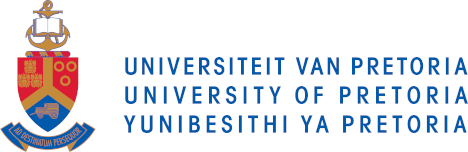

::: {.tagline}
Where spatial science meets epidemiology.
:::

::: {.hero-lede}
SEPIMOD, the Spatial Epidemiological Modelling Group, emerged in response to the COVID-19 outbreak in South Africa, uniting experts in spatial and epidemiological modeling from esteemed institutions such as the [University of Pretoria](https://www.up.ac.za/), the [University of Witwatersrand (WITS)](https://www.wits.ac.za/), the [Council for Scientific and Industrial Research (CSIR)](https://www.csir.co.za/), the [South African Medical Research Council (SAMRC)](https://www.samrc.ac.za/), and the [International Business Machines Corporation (IBM)](https://www.ibm.com/planetwide/za/). This collective endeavor was driven by the need for COVID-19 modeling that intricately considers spatial factors. Since then, SEPIMOD, has worked on various spatial modelling work related to COVID-19. Beyond its immediate mission, SEPIMOD is dedicated to enhancing research capabilities within South Africa and the broader African context. The group actively engages post-graduate students to nurture expertise in statistical and epidemiological spatial modeling, while forging collaborative relationships with institutions and researchers for a multifaceted impact.
:::

::: {.stats-row}
::: {.stat-tile}
[5]{.stat-number}
[Partner institutions]{.stat-label}
:::

::: {.stat-tile}
[12]{.stat-number}
[Researchers and advisors]{.stat-label}
:::

::: {.stat-tile}
[7]{.stat-number}
[Publications]{.stat-label}
:::

::: {.stat-tile}
[2020]{.stat-number}
[Founded]{.stat-label}
:::
:::

::: {.cta-row}
[Meet the team](members.qmd){.btn .btn-primary role="button"}
[Explore our research](research.qmd){.btn .btn-outline-secondary role="button"}
:::

## Our Approach

The team consists of experts from universities and science councils within South Africa that have all had close collaboration with government bodies and local municipalities during the COVID-19 pandemic in order to provide scientific outputs for decision support. The group has formed a consortium called SEPIMOD (Spatial EPIdemiological MODelling). The team has expertise in statistical modelling, spatial analysis, GIS, programming, and epidemiology, and has been extended to include experts in microbiology and wastewater analysis, climate sciences, logistics and supply chain modelling, systems modelling and simulation, and veterinary science, in order to provide a full skill set for tackling spatial epidemiological research.

::: {.partner-logos-section}
## Our Partner Institutions

::: {.partner-logos}
{.partner-logo-card}
{.partner-logo-card}
{.partner-logo-card .dark-chip}
{.partner-logo-card}
{.partner-logo-card}
:::
:::
