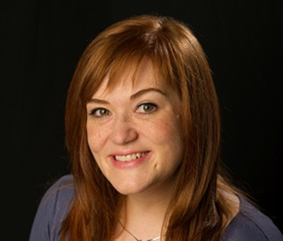
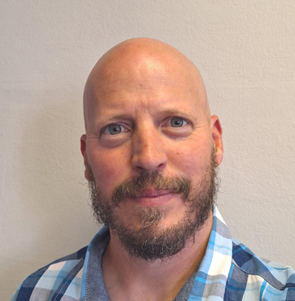
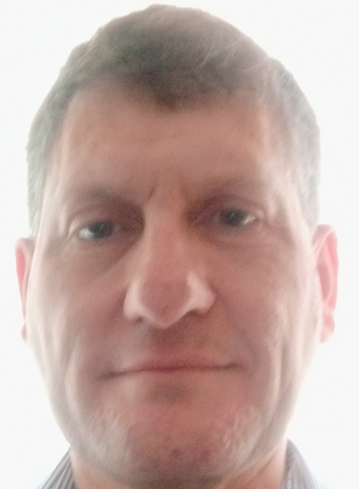

## Inger Fabris-Rotelli

Department of Statistics, University of Pretoria, South Africa

[Prof Inger Fabris-Rotelli](https://www.linkedin.com/in/inger-fabris-rotelli-7502a77b/) is currently an associate professor in the Department of Statistics at the [University of Pretoria](https://www.up.ac.za/). She has been at the Department of Statistics since 2004 and holds a PhD Mathematical Sciences (2013). Her research interests are in spatial statistics and GIS, as well as remote sensing and general image processing. The research focuses on applied areas, developing mathematical and statistical methodology for image processing, remote sensing and spatial statistics with impact in areas of criminology, epidemiology (COVID-19) and biostatistics, and informal road modelling. She served on the executive of the [South African Statistical Association (SASA)](https://www.sastat.org/home) from 2012 until 2018, and as a director on the [ICCSSA (Institute of Certificated and Chartered Statisticians in South Africa)](https://www.iccssa.org.za/about/) board from 2019. She is the current president of SASA and the CEO of ICCSSA. Among others she is also a member of ISI, ISPRS and IMS internationally, and the Golden Key Society, SASA, S2A3, SAMS, ICCSSA (registered as a Chartered Statistician from 2019 - 2023). She is a SACNASP council member for the period 2021 to 2025, is a Registered Professional Natural Scientist with SACNASP, and has a National Research Foundation Y2 rating in recognition of her research. She is an Abe Bailey Fellow (2007 tour award), and a 2018 fellow of the TUKS Young Researcher Leadership Program (TYRLP). She was selected as a BRICS Young Scientist 2020 (in Artificial Intelligence).

<a href="mailto:inger.fabris-rotelli@up.ac.za"> 📧 </a>

## Nada Abdelatif

Biostatistics Research Unit, South African Medical Research Council

Interest areas: Spatial modelling and the linkage between climate and environment and disease distribution as well as cluster randomized trials

<a href="mailto:inger.fabris-rotelli@up.ac.za"> 📧 </a>

## Raeesa Manjoo-Docrat

School of Statistics and Actuarial Sciences, University of the Witwatersrand

[Dr. Raeesa Manjoo-Docrat](https://www.linkedin.com/in/raeesa-docrat-88228bb1/) is a dedicated lecturer at the [University of the Witwatersrand](https://scholar.google.com/citations?user=nqGypBUAAAAJ&hl=en) since 2018, with specialised expertise in applied and spatial statistics, as well as survival analysis. She holds a BSc in Mathematics, a Postgraduate Diploma in Actuarial Sciences and Mathematical Statistics, and dual Honors in Mathematics and Statistics, where she distinguished herself by earning the prestigious Liberty Medal as the top Statistics Honours student. Raeesa completed her MSc with distinction in 2018, with a research focus on stochastic processes, and went on to achieve a PhD in the spatio-stochastic modeling of infectious diseases. Following this, she pursued a post-doctoral fellowship at Johns Hopkins University in the United States, where she focused on modeling tuberculosis spread.

Her research interests are centered on the advanced modelling of disease spread and the innovative application of spatial statistics. At Wits, Dr. Manjoo-Docrat is deeply committed to education, lecturing both undergraduate and postgraduate courses in statistics and related fields. Beyond the classroom, she actively supervises postgraduate research, guiding students in exploring novel approaches to infectious disease modeling and statistical applications. 

<a href="mailto:raeesa.docrat@wits.ac.za"> 📧 </a>

## Pravesh Debba

Smart Places Cluster, Council for Scientific and Industrial Research, South Africa

[Professor Pravesh Debba](https://www.linkedin.com/in/pravesh-debba-80117115/) was born in KwaZulu Natal, South Africa. He obtained a BSc degree with majors in Mathematics and Statistics from the University of KwaZulu-Natal (UKZN) in 1991. He completed an honours degree in Statistics from UKZN in 1992. In 1998, he completed an MSc degree in Biostatistics at Hasselt University in Belgium. He was awarded a full scholarship from the Flemish Ministry of Education during this period. He completed his PhD in Spatial Statistics in 2006 from the International Institute for Geo-Information Science and Earth Observation ITC and Wageningen University in the Netherlands. He was awarded a scholarship from ITC and grants from NRF Thuthuka during 2003--2008. Professor Debba is currently the manager for Inclusive Smart Settlements and Regions and Acting Centre Manager for the Energy Centre within Smart Places at the Council for Scientific and Industrial Research (CSIR). Professor Debba has been the president of the South African Statistical Association (SASA) from 2010--2011 and Chairperson of the Institute for Certificated and Chartered Statisticians of South Africa (ICCSSA) from 2014--2018. He was appointed as the chair of the Body of Trustees of ICCSSA from 2018-2022. Professor Debba has supervised MSc and PhD students. His research achievements include, about 50 national or international presentations at conferences or workshops, three popular articles, and over 50 peer-reviewed publications published at ISI rated journals or conference proceedings. He is also a co-producer of a technology demonstrator in the field of remote sensing. His field of applied research is in the areas of Remote Sensing, GIS, Spatial Statistics, Space-Time Models, Design of Optimal Sampling Schemes. His most recent awards include the 2020 SASA-SAS Thought Leadership Award, 2019 ICCSSA Charter Award, 2018 CSIR CEO Award, 2016 CSIR Management Excellence Award, 2016 and 2014 CSIR Collaboration Award.

<a href="mailto:pdebba\@csir.co.za"> 📧 </a>

## Jenny Holloway

NextGen Enterprises and Institutions, Council for Scientific and Industrial Research, South Africa

[Jenny Holloway](https://www.linkedin.com/in/jenny-holloway-821b95226/) is a senior statistician at the CSIR. She joined CSIR as a bursar in 1990 and has more than 30 years' experience working as a researcher at the CSIR. She holds an MSc in Mathematical Statistics from the University of Cape Town. Her initial experience at the CSIR involved systems analysis, design and programming but, after a few years, changed to focus more on data analysis, involving a range of statistical techniques and other quantitative methodologies. Her current expertise lies in the research and application of quantitative solutions to complex problems, particularly in the area of multivariate statistical modelling, with emphasis on regression and clustering; time series modelling and forecasting; as well as the design and implementation of simulation models. She also has expertise in programming using various software packages, with current projects involving Python. Recent research has also involved spatial statistics, particularly in the field of epidemiology. She is a chartered member of the institute for practising statisticians (ICCSSA, registered from 2013-2023) in the field of econometrics and a member of the South African Statistical Association (SASA).

<a href="mailto:jhollowa\@csir.co.za"> 📧 </a>

## Nontembeko Dudeni-Tlhone

Council for Scientific and Industrial Research (CSIR)

For the past 17 years, [Nontembeko Dudeni-Tlhone](www.linkedin.com/in/nontembekodudeni627926a) has worked in statistical research activities involving data analytics, statistical modelling, and data science activities within the Council for Scientific and Industrial Research, across domains such as health, energy, justice, environment, and urban planning. She has also provided statistical support in other CSIR research areas, mostly including providing assistance with questionnaire design, sampling strategy, and design of experiments. She obtained an MSc degree in Statistics from the University of Western Cape in 2007 and is currently pursuing her PhD at the University of KwaZulu-Natal in the field of remote sensing of environment. She is primarily interested in modelling high-dimensional hyperspectral data that incorporates a temporal component, gathered from remote sensing or the associated in-situ measurements. She is a member of the South African Statistical Society (SASA).

<a href="mailto:ndudenitlhone\@csir.co.za"> 📧 </a>

## Jabulani Jele

CSIR -Smart Places Cluster -- Urban and Regional Dynamics Research Group

[Jabulani Jele](https://www.linkedin.com/in/jabulani-jele-89797b244/) is a researcher with a background in GIS, statistical data analysis, and urban planning. His primary interests lie in the application of geospatial analysis within the fields of urban planning, epidemiology, and environmental studies. His focus is on utilizing geospatial analysis to support evidence-based decision-making within these fields. Jabulani holds an MSC qualification by coursework and research report in GIS and Remote Sensing from WITS University where he acquired the qualification with distinction. His master's research topic focused on COVID-19 modeling in Gauteng wards using a combination of multi-criteria decision analysis (MCDA) approaches such as the Analytical Hierarchy Process (AHP) and the Entropy Weight Method (EWM). He also holds an undergraduate qualification in Town and Regional Planning from the University of Pretoria. Before joining the CSIR, Jabulani worked at the Southern African Social Policy Research Institute (SASPRI), as a research officer, primarily undertaking research work that applied GIS analysis as well as deriving spatial measures of deprivation. Jabulani also worked as a GIS and Town Planning intern at the National Department of Planning Monitoring and Evaluations (DPME).

<a href="mailto:jjele\@csir.co.za"> 📧 </a>

## Rene Stander

Department of Statistics, University of Pretoria

[Rene Stander](https://www.linkedin.com/in/rene-stander-18b342148/) is a lecturer in the Department of Statistics at the University of Pretoria. Rene holds an MSc qualification in Advanced Data Analytics from the University of Pretoria. She is currently busy with her PhD in Mathematical Statistics also at the University of Pretoria. Rene's research area is Spatial Statistics with particular focus in spatial similarity measures, hotspot detection and hotspot prediction with application in criminology and disease modelling. Rene is also a member of the South African Statistical Association.

<a href="mailto:rene.stander\@up.ac.za"> 📧 </a>

## Lisa Schaefer (Née Burke)

Water Centre, Smart Places, Council for Scientific and Industrial Research (CSIR), South Africa

[Lisa Schaefer](https://www.linkedin.com/in/lisa-schaefer-3a17b7113/?originalSubdomain=za) is a microbiologist at the CSIR Water Centre where she is employed as a senior researcher. She holds an MSc in Microbiology from the University of Pretoria. Lisa’s area of specialisation lies in Environmental Microbiology with more than 20 years of experience. After completing her studies, she initially joined Sappi in 2006 as a biotechnology researcher examining microbial population structure in paper mill water systems and refining biotechnological solutions to improve pulp bleaching. In 2007 Lisa joined the CSIR, where she began investigating biological strategies for wastewater treatment. Here she gained skills in the use and adaptation of microorganisms for bioremediation and aquatic ecosystem restoration. Her current research focuses on the fate and persistence of microbial pathogens in water and the associated impact on human health. Her interests include wastewater-based epidemiological surveillance, developing novel detection methods for microbial pathogens and exploring water quality interventions for improving community health. Lisa is a member of the International Water Association, the National Legionella Action Group and the Rand Water Forum. She has experience in maintaining a SANAS accredited laboratory and is a technical signatory and analyst for facility T0657 for protozoan parasite analysis.

<a href="mailto:LSchaefer@csir.co.za "> 📧 </a>

## Wouter le Roux

Water Centre, Smart Places, Council for Scientific and Industrial Research (CSIR), South Africa

[Wouter le Roux](https://www.linkedin.com/in/wouter-le-roux-a4740a30/) was born in Mpumalanga, South Africa. He studied at the University of Pretoria, obtaining a degree in Microbiology in 2001, an honours degree in 2002, and a MSc (Microbiology) in 2006. His post-graduate studies were supported by a NRF scarce skills bursary. Wouter joined the National Health Laboratory Services (NHLS) in 2005, working on the analytical aspects of a HIV and HSV clinical trial. In 2006 he took up employment with the Council of Scientific and Industrial Research (CSIR) as a microbiologist in the Water and Human Health research group. Currently Wouter is a Senior Scientist within the CSIR’s Water Centre, he is also the Laboratory Manager for the SANAS accredited Microbiology and Parasitology Laboratory, and he manages various research projects in the field of water quality research. He has been a Research Associate at Nelson Mandela University since 2016 where he collaborates on research projects and supervises post-graduate students. His area of interests lie in the application of novel techniques and/or approaches in studying and understanding waterborne bacteria, parasites, and viruses, this to mitigate the risks associated with water-borne diseases. Wouter also has an interest in wastewater, raw water and treated water quality and their compliance to the applicable national standards. Lastly, he is also concerned with environmental water quality and how that affects ecosystem services.

<a href="mailto:wleroux@csir.co.za  "> 📧 </a>

## David Rose

School of Statistics and Actuarial Sciences, University of the Witwatersrand

[David Rose](https://za.linkedin.com/in/david-rose-9486135) is originally from Durban where he obtained his BSc and BSc (Hons) majoring in Mathematical Statistics, at the then University of Natal (UND). His Master’s dissertation at UND, as well as his PhD research at the University of Cambridge in the UK, was in the area of Queueing Theory and Queueing Networks.

After graduation, David worked in industry at De Beers in Johannesburg and Toronto. Here he gained on-the-job experience in Geostatistics, with a formal qualification in the field from the Centre de G ́eostatistique in Fontainebleau, France.

Dr Rose now works as a Senior Lecturer in the [School of Statistics and Actuarial Science at Wits](https://www.wits.ac.za/staff/academic-a-z-listing/r/davidrose1witsacza/).

<a href="mailto:david.rose1@wits.ac.za"> 📧 </a>
